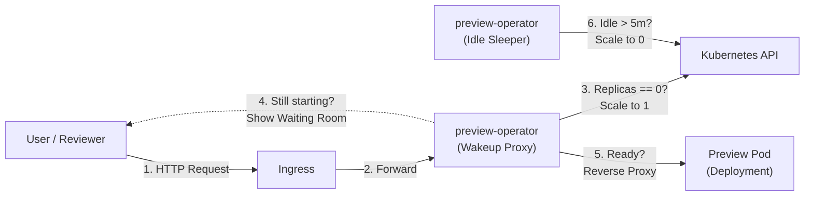

# preview-operator

> **Ultra-lightweight Kubernetes controller providing on-demand wakeup proxies and automated scale-to-zero for Pull Request preview environments.**

[](LICENSE)
[](go.mod)

`preview-operator` solves the resource-exhaustion dilemma of ephemeral preview environments. Instead of letting idle preview pods consume valuable CPU and RAM 24/7, `preview-operator` puts them to sleep (`replicas=0`) and transparently revives them (`replicas=1`) with an instant loading screen upon incoming HTTP traffic.

---

## Features

- ⚡ **Scale to Zero**: Automatically scales deployments to `replicas=0` after an inactivity timeout (e.g. `5m`, `30m`, `2h`).
- 🚀 **Zero-Wait Wakeup Proxy**: Intercepts HTTP requests and serves an auto-refreshing "Waking up preview..." waiting room while scaling back up.
- 🛡️ **Ultra-Lightweight**: Zero heavyweight dependencies. No Knative, Istio, or complex Service Meshes required. Single binary Alpine container (~15MB).
- 🔌 **Plug & Play**: Works alongside your existing Ingress and Deployments with standard Kubernetes RBAC.
- 🔄 **ArgoCD ApplicationSet Compatible**: Pairs seamlessly with ArgoCD Pull Request generators.

---

## How It Works



1. **When Idle**: Deployment is scaled to `replicas=0`. Cluster resources are fully conserved.
2. **On First Visit**: `preview-operator` intercepts traffic, issues `replicas=1` via `client-go`, and renders a responsive waiting room UI.
3. **When Pod is Ready**: The browser automatically refreshes and traffic is transparently reverse-proxied to the backend.
4. **On Inactivity**: A background goroutine checks the last request timestamp and scales the deployment back to `0`.

---

## Quickstart

### 1. Configuration (Environment Variables)

| Variable | Description | Default | Required |
|---|---|---|---|
| `TARGET_SERVICE_URL` | Upstream backend URL to reverse proxy to (e.g. `http://my-app:80`) | - | Yes |
| `DEPLOYMENT_NAME` | Target Kubernetes Deployment name to scale | - | Yes |
| `NAMESPACE` | Target Kubernetes Namespace | `default` | No |
| `IDLE_TIMEOUT` | Idle duration before sleeping (e.g. `5m`, `30m`, `2h`) | `2h` | No |
| `PORT` | Listening port for the operator proxy | `8080` | No |

### 2. Kubernetes Deployment Example

Deploy `preview-operator` in the target namespace and route your Ingress to `service/preview-operator:8080`:

```yaml
apiVersion: apps/v1
kind: Deployment
metadata:
  name: preview-operator
  namespace: preview-app
spec:
  replicas: 1
  selector:
    matchLabels:
      app: preview-operator
  template:
    metadata:
      labels:
        app: preview-operator
    spec:
      serviceAccountName: preview-operator-sa
      containers:
        - name: operator
          image: ghcr.io/aobaiwaki123/preview-operator:latest
          env:
            - name: TARGET_SERVICE_URL
              value: "http://my-app-service:80"
            - name: DEPLOYMENT_NAME
              value: "my-app"
            - name: NAMESPACE
              valueFrom:
                fieldRef:
                  fieldPath: metadata.namespace
            - name: IDLE_TIMEOUT
              value: "10m"
            - name: PORT
              value: "8080"
          ports:
            - containerPort: 8080
---
apiVersion: v1
kind: Service
metadata:
  name: preview-operator
  namespace: preview-app
spec:
  ports:
    - port: 8080
      targetPort: 8080
  selector:
    app: preview-operator
```

### 3. Required RBAC

The operator requires permission to `get` and `update` (patch) `scale` subresources on the target Deployment:

```yaml
apiVersion: v1
kind: ServiceAccount
metadata:
  name: preview-operator-sa
  namespace: preview-app
---
apiVersion: rbac.authorization.k8s.io/v1
kind: Role
metadata:
  name: preview-operator-role
  namespace: preview-app
rules:
  - apiGroups: ["apps"]
    resources: ["deployments", "deployments/scale"]
    verbs: ["get", "watch", "list", "update", "patch"]
---
apiVersion: rbac.authorization.k8s.io/v1
kind: RoleBinding
metadata:
  name: preview-operator-rb
  namespace: preview-app
subjects:
  - kind: ServiceAccount
    name: preview-operator-sa
roleRef:
  kind: Role
  name: preview-operator-role
  apiGroup: rbac.authorization.k8s.io
```

---

## Documentation

- [Architecture & Controller Best Practices](docs/architecture-and-best-practices.md): Deep dive into modular design, Clean Architecture, and Kubernetes SIGs best practices.
- [ArgoCD ApplicationSet Integration](docs/argocd-integration.md): Step-by-step recipe for automated PR lifecycle management.
- [Concept & Motivation](docs/concept.md): Why we built this, and how it compares to traditional CI setups.

---

## License

MIT License. See [LICENSE](LICENSE) for details.
