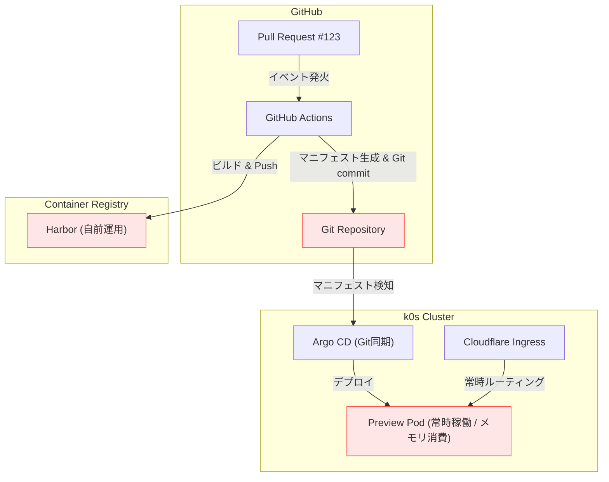
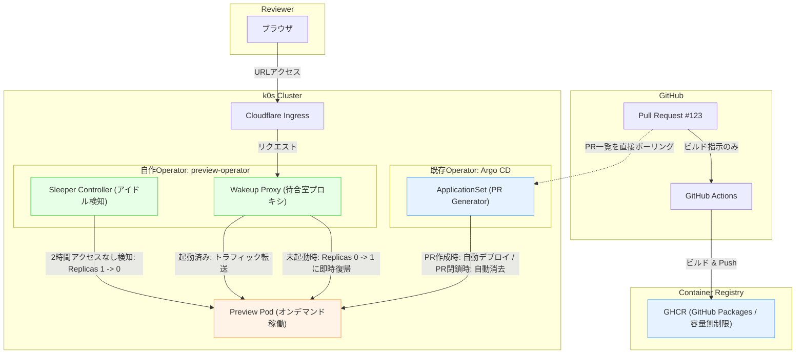

# preview-operator

おうちKubernetesにおけるPull Requestプレビュー環境の自律ライフサイクル（ArgoCD ApplicationSet）およびアイドル時自動スリープ（Scale to Zero）を提供する軽量コントローラー。

---

## Architecture: As-Is vs To-Be

### As-Is: CI駆動のGitOps（手動パイプライン）



---

### To-Be: CRD / Operator駆動（自律ライフサイクル & Scale to Zero）



---

## ArgoCD ApplicationSet Definition (PR Generator)

```yaml
apiVersion: argoproj.io/v1alpha1
kind: ApplicationSet
metadata:
  name: preview-environments
  namespace: argocd
spec:
  generators:
    - pullRequest:
        github:
          owner: AobaIwaki123
          repo: my-app
          tokenRef:
            secretName: github-token
            key: token
  template:
    metadata:
      name: 'preview-pr-{{number}}'
    spec:
      project: default
      source:
        repoURL: 'https://github.com/AobaIwaki123/my-app'
        targetRevision: '{{head_sha}}'
        path: k8s/preview
        helm:
          parameters:
            - name: image.tag
              value: '{{head_sha}}'
            - name: ingress.host
              value: 'pr-{{number}}.preview.example.com'
      destination:
        server: https://kubernetes.default.svc
        namespace: 'pr-{{number}}'
      syncPolicy:
        automated:
          prune: true
          selfHeal: true
```

---

## 自作Operator（preview-operator）の概要

Go言語で実装された、おうちKubernetesの計算資源を保護するための軽量コントローラー。

### 1. Wakeup Proxy (待合室プロキシ)
- Ingressからの初回リクエストを受け付ける超軽量リバースプロキシ（`net/http/httputil`）。
- 対象PRのPodが停止している（`replicas=0`）場合、`client-go` を介して `replicas=1` へ即時スケールアップ。
- 起動待機中はシンプルなローディングHTMLを返却し、PodのReady検知後に本来のアプリケーションへリダイレクト/透過転送。

### 2. Sleeper Controller (アイドル検知)
- プロキシが保持する各Preview環境の最終アクセス時刻（Last Accessed Timestamp）を監視。
- 指定時間（デフォルト: 2時間）無アクセスの環境を検知し、`replicas=0` にスケールダウンしてメモリ・CPUを解放。

---

## 開発ロードマップ (Roadmap)

- [ ] **Phase 1: 検証用 Sample App の作成と k8s デプロイ**
  - 軽量な検証用Webアプリ（Hello World / ステータス表示）の作成
  - GitHub Actions で GHCR へイメージプッシュ
  - 最小限の k8s マニフェスト（Deployment, Service, Ingress）をクラスタに手動デプロイして疎通確認
- [ ] **Phase 2: ArgoCD ApplicationSet (PR Generator) の疎通**
  - GitHub PRの作成をトリガーに、Sample Appが自動デプロイされることを確認
  - PR Close時にNamespaceごと自動削除されることを確認
- [ ] **Phase 3: Wakeup Proxy の実装（Go）**
  - `replicas=0` の状態でアクセスした際、「起動中...」画面を返却しつつ `client-go` で `replicas=1` にスケールアップ
  - Pod起動完了後に Sample App の画面へ透過転送/自動リダイレクト
- [ ] **Phase 4: Sleeper Controller (アイドル検知) の実装**
  - 最終アクセス時刻から一定時間（例: テスト時は2分、本番は2時間）経過で `replicas=0` へ自動スリープ
- [ ] **Phase 5: 社内LTスライドへの反映 ＆ デモ**
  - 実際のScale-to-Zeroと即時復帰の様子をスライド・デモとして組み込み、技術的エッジを披露

