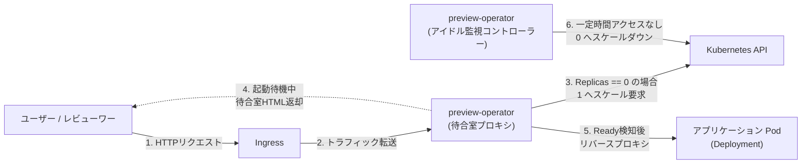

# preview-operator

Kubernetes上のプレビュー環境および個人開発サービス向けに、オンデマンド即時復帰プロキシとアイドル時自動スリープ（Scale to Zero）を提供する軽量コントローラー。

[](LICENSE)
[](go.mod)

`preview-operator` は、Pull Requestプレビュー環境や低頻度アクセスの個人開発本番サービスにおける計算資源の浪費を解消します。アクセスがない待機時間はPodをスリープ（`replicas=0`）させてCPU・メモリを解放し、HTTPリクエスト受信時に自律的にPodを復帰（`replicas=1`）させ、起動完了まで待合室画面を提供した上で本来のアプリケーションへ透過プロキシします。

---

## 主な機能

- **Scale to Zero（自動スリープ）**: 指定した無アクセス時間（例: `5m`, `30m`, `2h`）が経過すると、対象Deploymentを自律的に `replicas=0` へスケールダウンします。
- **待合室プロキシ（即時復帰）**: HTTPリクエストを傍受し、停止中の場合は `replicas=1` への復帰要求を発行。起動待機中は自動リロード付きの待合室画面を返却し、Ready検知後に本来のサービスへ透過転送します。
- **軽量・低オーバーヘッド**: KnativeやIstio等の大規模なサービスメッシュやCRDボイラープレートを必要としません。Go標準ライブラリと公式 `client-go` のみで構築された単一バイナリコンテナ（Alpineベース、約15MB）で動作します。
- **プラグアンドプレイ**: 既存のDeploymentおよびIngressのルーティング先に指定するだけで動作します。
- **ArgoCD ApplicationSet親和性**: ArgoCDのPull Requestジェネレータと組み合わせることで、PRの作成からスリープ、PR閉鎖時の自動削除まで完全な自律ライフサイクルを実現します。

---

## アーキテクチャと動作の流れ



1. **アイドル時**: Deploymentは `replicas=0` で停止しており、クラスタリソースを消費しません。
2. **初回アクセス**: ユーザーがURLを開くと、`preview-operator` がリクエストを受け付け、`client-go` 経由で対象Deploymentを `replicas=1` へスケールアップします。
3. **起動待機中**: ブラウザには軽量なローディング画面（待合室）が返却され、数秒おきに自動リロードされます。
4. **起動完了**: PodがReadyになると、プロキシが本来のバックエンドサービスへ透過的にトラフィックを中継します。
5. **無アクセス検知**: 内部タイマーが最終リクエスト時刻を監視し、無アクセス時間が閾値を超えると自動で `replicas=0` に戻します。

---

## クイックスタート

### 1. 環境変数設定

| 環境変数 | 説明 | デフォルト値 | 必須 |
|---|---|---|---|
| `TARGET_SERVICE_URL` | プロキシ先の上流サービスURL（例: `http://my-app:80`） | - | 必須 |
| `DEPLOYMENT_NAME` | スケール操作の対象となるKubernetes Deployment名 | - | 必須 |
| `NAMESPACE` | 対象リソースが存在するKubernetes Namespace | `default` | 任意 |
| `IDLE_TIMEOUT` | スリープまでの無アクセス待機時間（例: `5m`, `30m`, `2h`） | `2h` | 任意 |
| `PORT` | オペレータープロキシのリスニングポート | `8080` | 任意 |

### 2. デプロイ例 (Deployment & Service)

対象アプリケーションと同じNamespaceに `preview-operator` をデプロイし、Ingressの宛先サービスを本オペレーター（ポート8080）に向けます。

```yaml
apiVersion: apps/v1
kind: Deployment
metadata:
  name: preview-operator
  namespace: preview-app
spec:
  replicas: 1
  selector:
    matchLabels:
      app: preview-operator
  template:
    metadata:
      labels:
        app: preview-operator
    spec:
      serviceAccountName: preview-operator-sa
      containers:
        - name: operator
          image: ghcr.io/aobaiwaki123/preview-operator:latest
          env:
            - name: TARGET_SERVICE_URL
              value: "http://my-app-service:80"
            - name: DEPLOYMENT_NAME
              value: "my-app"
            - name: NAMESPACE
              valueFrom:
                fieldRef:
                  fieldPath: metadata.namespace
            - name: IDLE_TIMEOUT
              value: "10m"
            - name: PORT
              value: "8080"
          ports:
            - containerPort: 8080
---
apiVersion: v1
kind: Service
metadata:
  name: preview-operator
  namespace: preview-app
spec:
  ports:
    - port: 8080
      targetPort: 8080
  selector:
    app: preview-operator
```

### 3. 必要なRBAC設定

本オペレーターは、対象Deploymentのスケール情報取得および更新（Patch）を行うための権限が必要です。

```yaml
apiVersion: v1
kind: ServiceAccount
metadata:
  name: preview-operator-sa
  namespace: preview-app
---
apiVersion: rbac.authorization.k8s.io/v1
kind: Role
metadata:
  name: preview-operator-role
  namespace: preview-app
rules:
  - apiGroups: ["apps"]
    resources: ["deployments", "deployments/scale"]
    verbs: ["get", "watch", "list", "update", "patch"]
---
apiVersion: rbac.authorization.k8s.io/v1
kind: RoleBinding
metadata:
  name: preview-operator-rb
  namespace: preview-app
subjects:
  - kind: ServiceAccount
    name: preview-operator-sa
roleRef:
  kind: Role
  name: preview-operator-role
  apiGroup: rbac.authorization.k8s.io
```

---

## 設計思想と将来のロードマップ

### 設計思想
本プロジェクトは、CRDの肥大化や重量級フレームワーク（Kubebuilder等）の導入をあえて避け、`client-go` の基本APIを用いた「最小限のGo実装による信頼性の担保」を原則としています。

### 将来の拡張計画 (Roadmap)
- **Self-Healing Rollback（自動ロールバック復帰）**:
  起動要求時に `ImagePullBackOff` や `CrashLoopBackOff` 等のコンテナ異常を検知した場合、Kubernetesが保持する過去のReplicaSet履歴（`revision`）を参照し、直前の正常稼働バージョンへ自律的にロールバックして無停止復帰を提供する機能。
- **待合室UIのカスタマイズ**:
  環境変数やConfigMap経由で任意のHTML/CSSテンプレートまたはタイトルを注入可能にする機能。

---

## ドキュメント一覧

- [アーキテクチャ設計とベストプラクティス](docs/architecture-and-best-practices.md): モジュール分割、Clean Architectureの適用、Kubernetes SIGs公式の設計指針。
- [ArgoCD ApplicationSet 連携ガイド](docs/argocd-integration.md): Pull Requestジェネレータを用いたプレビュー環境の完全自動化設定例。
- [設計動機と背景（As-Is vs To-Be）](docs/concept.md): 手動CIパイプラインの限界と、自律Operatorによる計算資源保護の思想。

---

## ライセンス

MIT License。詳細は [LICENSE](LICENSE) を参照してください。
