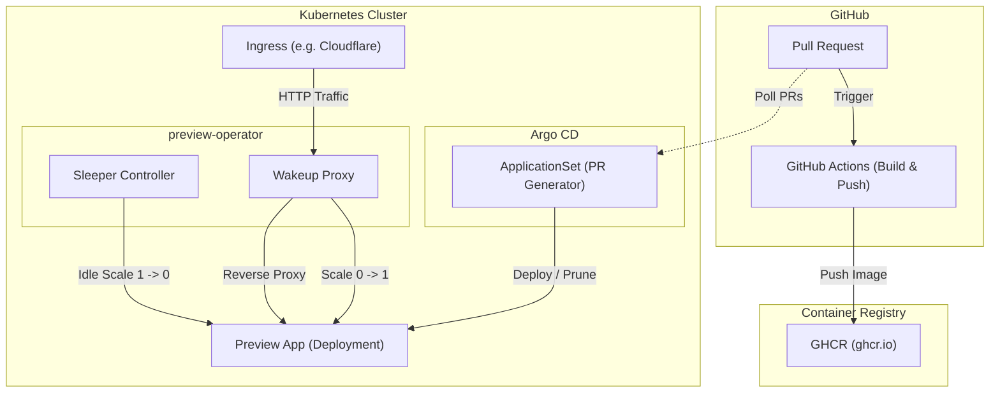

# ArgoCD ApplicationSet Integration Guide

`preview-operator` can be seamlessly integrated with ArgoCD's Pull Request generator (`ApplicationSet`) to enable full-lifecycle preview environments with automated scale-to-zero capabilities.

---

## Complete Workflow Architecture



---

## ArgoCD ApplicationSet Manifest

Below is a production-ready `ApplicationSet` manifest targeting GitHub pull requests:

```yaml
apiVersion: argoproj.io/v1alpha1
kind: ApplicationSet
metadata:
  name: preview-environments
  namespace: argocd
spec:
  generators:
    - pullRequest:
        github:
          owner: <GITHUB_OWNER>
          repo: <GITHUB_REPO>
          tokenRef:
            secretName: github-token
            key: token
  template:
    metadata:
      name: 'preview-pr-{{number}}'
    spec:
      project: default
      source:
        repoURL: 'https://github.com/<GITHUB_OWNER>/<GITHUB_REPO>'
        targetRevision: '{{head_sha}}'
        path: k8s/preview
        helm:
          parameters:
            - name: image.tag
              value: '{{head_sha}}'
            - name: ingress.host
              value: 'pr-{{number}}.preview.example.com'
      destination:
        server: https://kubernetes.default.svc
        namespace: 'pr-{{number}}'
      syncPolicy:
        automated:
          prune: true
          selfHeal: true
```

### Key Highlights
- **Dynamic Namespace Isolation**: Each PR gets its own namespace (`pr-{{number}}`), ensuring multi-tenant isolation.
- **Automated Lifecycle**: When the PR is closed or merged, ArgoCD automatically prunes the namespace, removing all related deployments and ingress resources.
- **Resource Protection**: Paired with `preview-operator`, idle preview environments sleep after inactivity, conserving cluster CPU and RAM.
