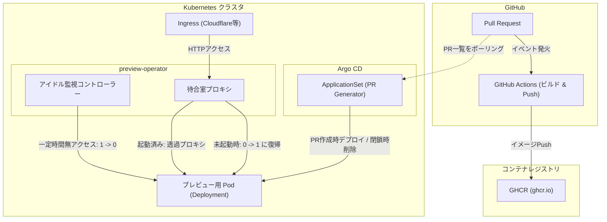

# ArgoCD ApplicationSet 連携ガイド

`preview-operator` は、ArgoCD の Pull Request ジェネレータ（`ApplicationSet`）と組み合わせることで、Pull Requestごとのプレビュー環境の自動生成から無アクセス時の自動スリープ、PR閉鎖時の自動削除まで、ライフサイクル全体の完全自律化を実現します。

---

## 連携アーキテクチャ



---

## ArgoCD ApplicationSet マニフェスト例

GitHub Pull Request を対象とする本番運用向け `ApplicationSet` の定義例です。

```yaml
apiVersion: argoproj.io/v1alpha1
kind: ApplicationSet
metadata:
  name: preview-environments
  namespace: argocd
spec:
  generators:
    - pullRequest:
        github:
          owner: <GITHUB_OWNER>
          repo: <GITHUB_REPO>
          tokenRef:
            secretName: github-token
            key: token
  template:
    metadata:
      name: 'preview-pr-{{number}}'
    spec:
      project: default
      source:
        repoURL: 'https://github.com/<GITHUB_OWNER>/<GITHUB_REPO>'
        targetRevision: '{{head_sha}}'
        path: k8s/preview
        helm:
          parameters:
            - name: image.tag
              value: '{{head_sha}}'
            - name: ingress.host
              value: 'pr-{{number}}.preview.example.com'
      destination:
        server: https://kubernetes.default.svc
        namespace: 'pr-{{number}}'
      syncPolicy:
        automated:
          prune: true
          selfHeal: true
```

### 設計上の要点
- **Namespace 分離**: PR番号ごとに独立した Namespace（`pr-{{number}}`）を動的生成し、マルチテナント間の干渉を防止します。
- **自律ライフサイクル**: PR がクローズまたはマージされると、ArgoCD の Prune 機能によって対象 Namespace および関連リソース（Deployment, Service, Ingress）が自動消去されます。
- **計算資源の保護**: `preview-operator` が常駐することで、作成されたプレビュー環境が無人の間は `replicas=0` で待機し、CPU・メモリ消費を最小化します。
