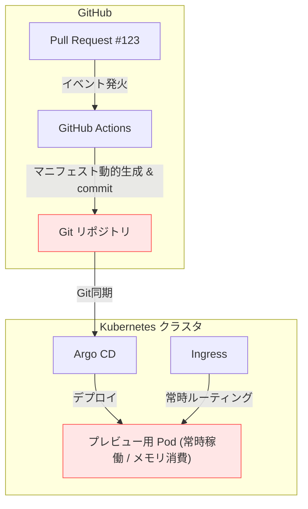
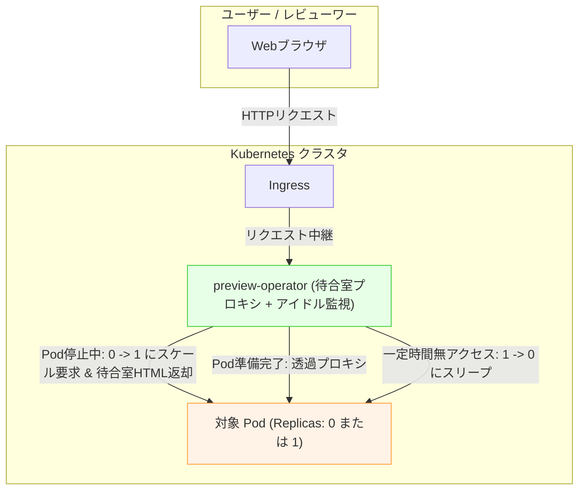

# 設計動機と背景：なぜ preview-operator を作るのか

Kubernetes を活用した開発フローにおいて、Pull Request ごとに独立した検証用プレビュー環境を提供することは、レビューの摩擦を劇的に減らすベストプラクティスです。しかし、オンプレミス・おうちクラスタやコスト重視の開発環境において、複数のプレビュー環境を常時稼働させることは深刻な CPU・メモリ枯渇（OOMKill）を引き起こします。

また、個人開発のWebサービスや検証環境においても、「月数回しかアクセスされないサービス」が常時リソースを占有し続ける課題があります。

---

## 変遷：As-Is（従来型）vs To-Be（本オペレーター）

### 従来型（As-Is）：CI駆動の手動生成パイプライン

従来のCI中心の構成では、GitHub Actions 等が動的にマニフェストを生成し、GitリポジトリへコミットしてArgoCDに同期させる方式が一般的でした。

**課題と摩擦:**
- **リソースの枯渇**: レビューが行われていない深夜や週末もPodが動き続け、メモリを占有する。
- **Git履歴の汚染**: 自動生成マニフェストのコミットがGitログを埋め尽くす。
- **コストと運用負荷**: クラウド費用の増大や、ローカルクラスタでのリソース制限。

---

### 本オペレーター（To-Be）：自律型 Scale-to-Zero & 待合室即時復帰

`preview-operator` を導入することで、Pod は「実際にアクセスされている時間だけ」クラスタリソースを消費します。

**本設計のメリット:**
1. **待機時リソースゼロ**: アイドル期間中は `replicas=0` となり、CPU・メモリ消費がゼロになります。
2. **502/503エラーのないUX**: コールドスタート時もBad Gatewayエラーを返さず、自動リロード付きの待合室画面でスムーズに起動を待たせます。
3. **インフラの単純性**: KnativeやIstio等の大規模なサービスメッシュを導入することなく、軽量コンテナ1つを配置するだけで機能します。
4. **個人開発サービスへの応用**: PRプレビュー環境だけでなく、アクセス頻度の低い個人開発の本番Webサービスのリソース節約にも活用可能です。
