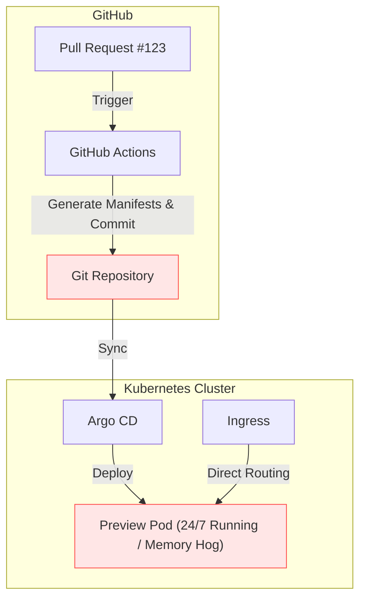
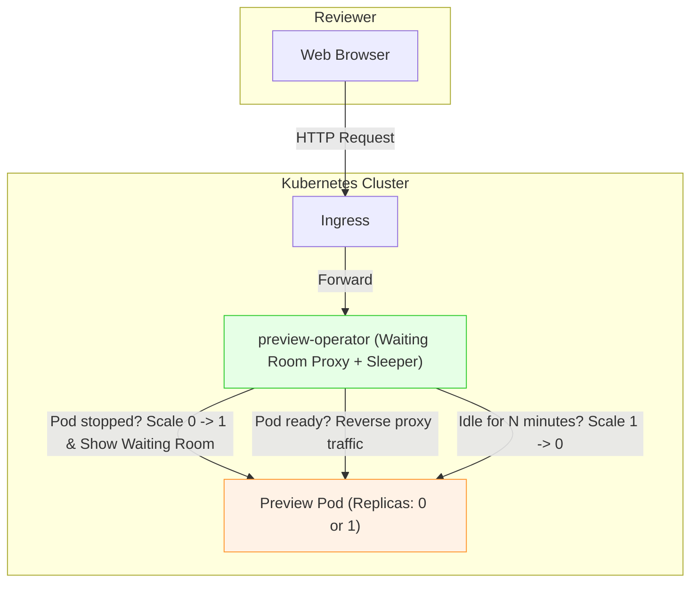

# Concept & Motivation: Why preview-operator?

In Kubernetes-based development workflows, providing isolated, on-demand preview environments for every Pull Request is one of the most effective ways to accelerate code reviews. However, in resource-constrained environments (such as bare-metal clusters, homelabs, or cost-sensitive development clusters), running dozens of active preview deployments simultaneously causes severe CPU and memory contention.

---

## Evolution: As-Is vs To-Be

### As-Is: CI-Driven Manual Pipelines (Heavy & Resource-Intensive)

In traditional setups, CI runs custom bash scripts or automation to generate manifests and deploy preview pods that run 24/7 until manually cleaned up.

**Pain Points:**
- **Resource Exhaustion**: Pods run continuously even when reviewers are away or sleeping.
- **Git Repo Pollution**: Generating dynamic manifests directly in Git repos clutters commit history.
- **Cost**: Unnecessary cloud compute bills or OOMKills in local bare-metal clusters.

---

### To-Be: Operator-Driven Scale-to-Zero & Instant Wakeup

With `preview-operator`, preview pods consume cluster resources **only when being actively viewed**.

**Key Advantages:**
1. **Zero Footprint When Idle**: Scales deployments to 0 replicas after an idle period.
2. **Transparent User Experience**: Reviewers see a fast, auto-refreshing "Waking up preview..." page rather than a 502/503 Bad Gateway error.
3. **No Complex Infrastructure**: No Service Mesh (Istio/Linkerd) or Knative required. Just a single Go container deployed alongside your app.
